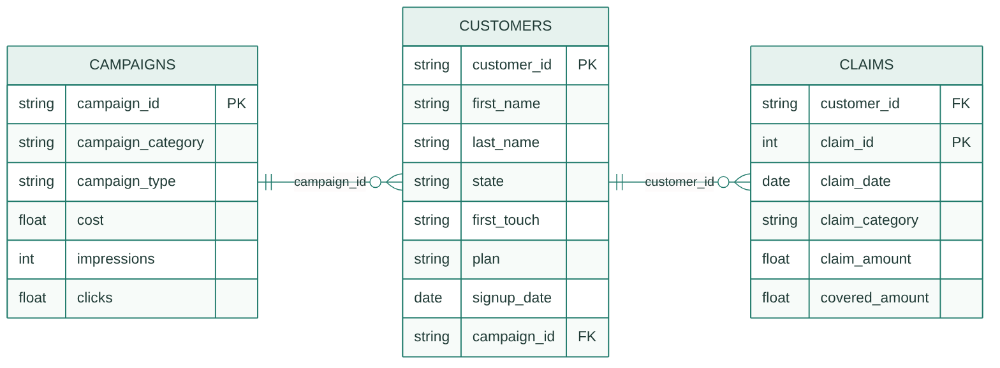
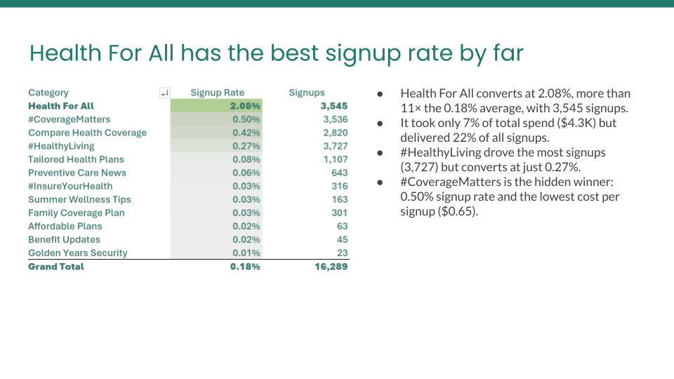
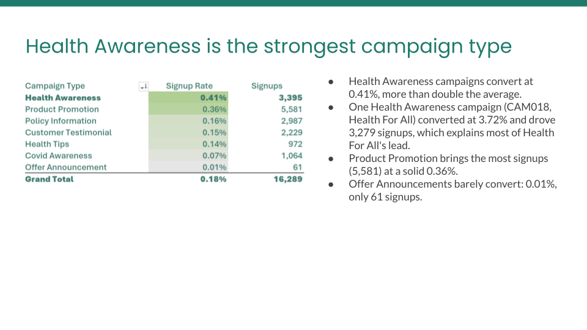

# Row Health Marketing Insights – Project Overview

## Analysing five years of marketing campaigns at Row Health to recommend where next year's marketing budget should go.

**Row Health is a US medical insurance company** offering four plans: bronze, silver, gold and platinum. **Between 2019 and 2023 it ran 57 marketing campaigns** across 12 categories (such as Health For All, #HealthyLiving and Golden Years Security) and 7 campaign types (such as Health Awareness, Product Promotion and Offer Announcement), spending $60.2K in total.

With a new data team in place, the company wants to understand which campaigns actually work before setting next year's budget. The budget has two goals: 1) **increase customer signups**, and 2) **raise brand awareness** across the country.

**Tools:** Excel (Power Query, COUNTIF, pivot tables with calculated fields) · Tableau · Google Slides

## Dataset Structure

The dataset has three tables: **campaigns** (57 rows: category, type, cost, impressions, clicks), **customers** (16,338 rows: plan, state, first touch, signup date and the campaign they signed up through) and **claims** (49,998 rows: claim category, amount and covered amount).

## Insights Summary

#### Campaign performance was evaluated on three key metrics:

- **Signup Rate**: the percentage of people who see a campaign and then sign up for a plan (signups ÷ impressions).
- **Cost per Signup**: the average amount spent to acquire one signup (cost ÷ signups).
- **Click Through Rate (CTR)**: the percentage of people who see a campaign and click its link (clicks ÷ impressions).

**Overall (2019–2023):** 0.18% signup rate · $3.70 cost per signup · 9.4% CTR · 16,289 signups from 9.1M impressions.

#### Signup Rate

- **Health For All** has by far the best signup rate at **2.08%**, more than 11× the 0.18% average. It received only 7% of total spend ($4.3K) but delivered 22% of all signups (3,545).
- Most of that comes from a single **Health Awareness** campaign (CAM018), which converted at **3.72%** and produced 3,279 signups.
- By campaign type, **Health Awareness** converts best (0.41%) and **Offer Announcement** worst (0.01%, only 61 signups).
- **#HealthyLiving** brought in the most signups (3,727) but converts at only 0.27%.

#### Click Through Rate

- **Health For All (25.5%)** and **Benefit Updates (22.2%)** have CTRs 2–3× the 9.4% average. **Golden Years Security** has the lowest at 1.4%.
- **Family Coverage Plan** had 1.1M impressions but no recorded clicks, yet still produced 301 signups. Its click data is missing for all three of its campaigns.
- Three of the four Health For All campaigns also logged 0 clicks, even though one of them (CAM033) produced 266 signups. Click tracking needs fixing before CTR can be fully trusted.

#### Cost per Signup

- **Golden Years Security** costs **$176.73 per signup**, 48× the $3.70 average, for only 23 signups.
- **Offer Announcement** campaigns cost $99.70 per signup: $6.1K spent for 61 signups.
- **COVID campaigns** cost $14.0K across 12 campaigns. Seven produced zero signups ($7.3K spent), and two more cost over $1,200 for a single signup each.
- The cheapest categories are **#CoverageMatters ($0.65)**, Health For All ($1.23) and #HealthyLiving ($1.79).

#### Claims

- Customers from **Compare Health Coverage** have the highest average claim ($410, against $267 overall) and account for 29% of all claim value from 17% of signups. Its $3.56 cost per signup looks reasonable, but the customers it brings in cost more to cover.

## Recommendations

- **Scale Health For All**: it has the best signup rate and CTR on only $4.3K of spend. Model new campaigns on CAM018's Health Awareness approach.
- **Back #CoverageMatters**: the cheapest signups at $0.65 each, with a solid 0.50% signup rate.
- **Cut Golden Years Security and Offer Announcement campaigns** ($176.73 and $99.70 per signup) and move that budget to the categories above.
- **Review COVID campaigns**: $7.3K went to seven campaigns with zero signups. Pause them unless there is a clear awareness case.
- **Fix click tracking** for Family Coverage Plan and Health For All before the next budget cycle.

## Data Quality Notes

- Clicks are missing for 3 Family Coverage Plan campaigns, and 8 campaigns have fractional click values (e.g. 1,348.5).
- 49 customers have a blank or "unknown" campaign_id and are excluded from campaign-level metrics.
- There are no impressions by channel, so signup rate can't be calculated by first-touch channel (social, referral, etc.).

## Dashboard

The interactive dashboard is on Tableau Public [here](https://public.tableau.com:9443/views/RowHealthProject_17953408688600/Dashboard1?:language=en-GB&publish=yes&:sid=&:redirect=auth&:display_count=n&:origin=viz_share_link) It can be filtered by plan, state and campaign type, and covers marketing metrics, signup metrics and claim metrics.

The dashboard includes all 16,338 customers. Campaign-level figures in this README exclude 49 customers with no valid campaign_id.

## Presentation

The presentation for the marketing team walks through these insights and recommendations and can be found [here](https://docs.google.com/presentation/d/10-N7aHpdqt00mjYltsYp19-Qp7ofWi4V1xUJnqM-0cc/edit?usp=sharing).

